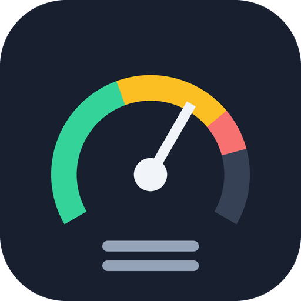

# context-coach

[](https://github.com/p4302840-netizen/context-coach/actions/workflows/test.yml)

给 Claude Code 用的上下文教练：在输入框上方实时显示上下文大小和 token 用量。对话变长后，由 Claude 判断现在该接着做、压缩，还是开新对话，点一下按钮就能执行。

终端和桌面应用（Code 标签页）都能用。界面有中文和英文，默认跟随系统语言。

```
建议压缩 · 上下文 16.2万 / 100万
下一步还要接着改这个项目
本对话 ≈ 61万 token（按输入价折算，实际处理 523万） · 上一轮 ≈ 9.8万 · 今天 ≈ 230万 · 5小时额度 23% · 缓存保留到 15:42
[ 压缩 ]  [ 带摘要开新对话 ]  [ 新对话 ]  [ 隐藏 ]  [ 详情 ]
```

## 安装

在 Claude Code 里输入（需要 2.1.275 或更新版本，在 2.1.326 上测试过）：

```
/plugin install context-coach --marketplace p4302840-netizen/context-coach
```

也可以分两步：

```
/plugin marketplace add p4302840-netizen/context-coach
/plugin install context-coach@context-coach
```

## 它做什么

**一直显示**

- 上下文大小：`上下文 8万 / 100万 · 15万 时提醒`
- token 用量，每次请求后立刻更新：本对话和本轮（或上一轮）用了多少，按输入价折算成等效 token，后面附上实际处理的总量；还有今天所有对话加起来用了多少
- 套餐额度：订阅用户会看到 5 小时和 7 天额度的已用百分比；按 API 计费的用户会看到估算费用
- 缓存能保留到几点：在那之前发下一条消息，上下文都按缓存价读取
- **详情**按钮：列出上下文里都装了什么（消息、系统工具、MCP 工具、技能……），以及哪几个连接器占得最多。用不到的连接器关掉，每个新对话开局都能省下这些

**缓存过期时（上下文 10 万以上）**，提醒你下一条消息要按全价重读整个上下文，并给出「新对话 / 压缩 / 知道了」。这时候用不到这段对话的话，开新对话最省

**超过阈值后（默认 15 万 token）**，每轮结束时由 Claude 判断。5 小时额度用到 80% 以上时，阈值自动降到三分之二（默认 10 万），提前提醒：

- **任务还没做完**：提示"做完后再压缩"
- **做完了，下一步还要用到这段对话**：建议压缩，并附上压缩时要保留的内容
- **做完了，后面用不上这段对话**：建议开新对话

## 按钮

- **压缩**：一键压缩，自动带上 Claude 给的"要保留什么"。压缩后先显示「已压缩」，下一轮结束后再显示新的上下文大小
- **带摘要开新对话**：先确认。Claude 写一份交接摘要，然后清空对话，把摘要放进新对话的输入框，你看过、改好再发送。如果放不进输入框，上方会出现「放进输入框 / 直接发送 / 丢弃」
- **新对话**：先确认，再清空对话（`/clear`），什么都不带
- **隐藏**：收起提醒，直到 Claude 下次给出建议
- **详情**：看上下文构成，再点「收起」回到原来的样子

如果你没理会建议、继续发消息，插件会安静一段时间，直到上下文再涨 5 万 token 才再次提醒。

## 用量记录

在输入框输入 `/context-coach`，列出最近 7 天每天用了多少、今天每个对话各用了多少（对话按你发的第一条消息命名）：

```
context-coach 用量记录（按输入价折算的 token）

最近 7 天：
  11-20 今天 ≈ 230万 · 2 个对话
  11-19 昨天 ≈ 480万 · 5 个对话
  合计 ≈ 710万

今天的对话：
  ≈ 150万 · 修好压缩按钮（当前）
  ≈ 80万 · 帮我写周报
```

## 数字怎么看

- **上下文**：下一次请求要发给 Claude 的全部内容，包括系统提示和工具说明。桌面应用里，新对话一开始就有 6 万多
- **本对话 ≈ X token**：把每次请求按 API 价格折算成普通输入 token 再加起来：缓存读按 1/10 算，缓存写按 1.25 倍（5 分钟缓存）或 2 倍（1 小时缓存）算，输出按 5 倍算。这个数最接近真实消耗。子代理和压缩本身的请求也算在内
- **实际处理**：所有请求的 token 原样相加。Claude 每调用一次工具就是一次请求，每次都要把整个上下文读一遍，所以这个数很大，其中绝大部分是便宜的缓存读
- **5小时额度 / 7天额度**：API 报告的套餐已用百分比，只有订阅用户才有
- **约 $X（估算）**：Claude Code 按标价算的本次会话费用，只在按 API 计费时显示，不是账单
- **缓存保留到 15:42**：根据最近一次请求和缓存时长（5 分钟或 1 小时，从 API 返回的用量里看出来）算出来的
- 计数跟着对话走：关掉再恢复的对话会接着之前的数算，`/clear` 后从零开始。插件保留最近 50 个对话的计数和最近 30 天的用量记录

## 什么时候清理最划算

每次请求的花费和上下文大小成正比，而压缩本身也要花一次请求的钱（写摘要、重建缓存）。大致规律：

| 总上下文 | 建议 |
|---|---|
| 10 万以下 | 不用管，压缩省下的抵不上它本身的成本 |
| 10–15 万 | 任务做完后，下一件事不相关就开新对话，相关就继续 |
| **15–20 万** | **性价比最高：做完当前任务就清理** |
| 20 万以上 | 在开始下一个任务之前清理 |

另外：

- **任务做到一半别压缩**：细节会丢，Claude 得重新读文件，反而更费
- **要离开到「缓存保留到」那个时间以后，先清理再走**：缓存过期后，下一条消息要按全价重新读整个上下文。忘了也没关系，回来时插件会提醒你

## 设置

在插件设置里可以改：

- `threshold`：提醒阈值，单位 token，默认 150000
- `quotaAlert`：5 小时额度用到这个百分比后提前提醒（阈值降到三分之二），默认 80，填 0 关闭
- `language`：界面语言，`auto`（跟随系统，默认）、`zh` 或 `en`
- `showMeter`：没到阈值时也显示上下文大小，默认开启
- `showUsage`：显示 token 用量、套餐额度和缓存时间，默认开启
- `debug`：把每次点击和每一步结果写进插件文件夹里的 `debug.log`，排查按钮没反应时用，默认关闭

## 省 token 的设计

- 没到阈值时，不往对话里加任何东西
- 超过阈值后，提醒附在你发的那条消息旁边，不改系统提示，不会让缓存失效
- Claude 每轮调用一次 `advise` 工具报告判断，多一次很小的请求
- 交接摘要由当前对话直接写，读的是已缓存的内容

## 隐私

插件不联网，不收集也不发送任何数据。用量数字来自 Claude Code 本身。每个对话的计数和每天的用量记录存在本机的插件存储里，`debug.log` 只在你打开 `debug` 后写在本机。

## 为什么是插件，不是 skill

skill 只是给 Claude 的说明，没法在输入框上方画提示、加按钮，也拿不到每次请求的 token 用量。这些都需要插件的 hooks 模块，所以 context-coach 做成了插件，安装方式见上面。

## 开发

```
claude plugin test plugins/context-coach
claude plugin validate .
```

每次推送到 GitHub，都会自动跑一遍校验和测试（见 `.github/workflows/test.yml`）。

## English

context-coach is a context coach for Claude Code. Above the prompt it shows, live:

- the context size, and when the reminder starts;
- this conversation's and the latest turn's token use, priced in input tokens (cache reads at a tenth, cache writes at 1.25 or 2, output at 5), beside the raw total processed;
- the plan's five-hour and seven-day usage on a subscription, or the cost estimate when billed by the API;
- until when the prompt cache holds.

Past a threshold (150k tokens by default; two thirds of it once the five-hour limit is 80% used), Claude judges at the end of each turn whether to keep going, compact (with what the summary must keep) or start a new conversation, and the band offers one-click buttons: **Compact**, **New with handoff note** (Claude writes a note, the conversation clears, the note waits in the prompt box), **New conversation**, **Hide** and **Details** (what the context holds, and the connectors that take the most). When the cache lapses over a large context, it warns that the next message re-reads it all at full price. The count follows the conversation across resumes, the usage row adds today's total over every conversation, and `/context-coach` lists the last 7 days and each of today's conversations.

Install with `/plugin install context-coach --marketplace p4302840-netizen/context-coach` (Claude Code 2.1.275 or later). The UI follows the system language (Chinese or English); set `language` to `zh` or `en` to pick one. Other options: `threshold`, `quotaAlert`, `showMeter`, `showUsage`, `debug`.

## License

MIT
